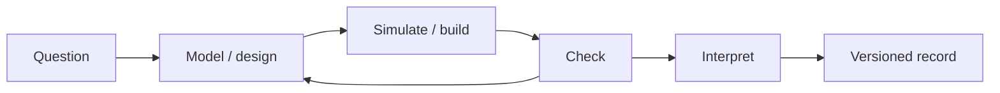

# Mingze Wang

**Aerospace engineering · Scientific instrumentation · Research software**

I'm Mingze Wang, also known as **Huaqing**, an aerospace engineering student at **Beihang University**. I work across numerical modelling, embedded systems and research software, with a research focus on **laser diagnostics and scientific instrumentation**.

I am interested in connecting physical questions with models, working hardware and measurements that can be checked.

[Website & project archive](https://izumikonatalab.com/) · [Public repositories](https://github.com/huaqing0617-wang?tab=repositories) · [Email](mailto:huaqing0617@gmail.com)

## Research & engineering

**Measurement.** Developing the optical foundations for laser measurement instrumentation, including physical optics, laser physics and optical diagnostics.

**Computation.** Numerical modelling, parameter studies and analysis of time-dependent systems. I care about baselines, assumptions, periodic stability and the limits of each result.

**Systems.** Embedded control, sensing, electronics and hardware integration, with STM32 and Raspberry Pi platforms.

Selected project records:

| Project | Focus | Scope |
|:--|:--|:--|
| [Wall Patrol One](https://izumikonatalab.com/projects/wall-patrol-one/) | Magnetic wall-inspection robotics; STM32G474, Raspberry Pi 5 and CAN | Hardware and firmware development; integration in progress |
| [SWUM Swimming Research](https://izumikonatalab.com/projects/swum/) | Swimming hydrodynamics, multi-cycle analysis and parameter interactions | Numerical studies; archived stages |
| [Three-Energy UAV](https://izumikonatalab.com/projects/three-energy-uav/) | Solar, Li-ion and hydrogen fuel-cell systems; mass closure and energy management | Simulation and hardware studies |

## Public projects

### [ResearchLLM](https://github.com/huaqing0617-wang/ResearchLLM)

A local research knowledge project exploring file synchronization, structured retrieval and answers with source references. Research materials remain the source of truth as models and indexes change.

**Research prototype · Public technical showcase.** The repository documents scope, development history and validation summaries; internal implementation is not distributed there.

### [Token Usage Dashboard](https://github.com/huaqing0617-wang/token-usage-dashboard)

A DeepSeek Harness plugin for viewing official Platform usage alongside local session accounting, with token, spend, balance and model views.

**Active prototype.** Official and local accounting have distinct scopes. Live verification and remaining checks are recorded in the [verification notes](https://github.com/huaqing0617-wang/token-usage-dashboard/blob/main/docs/verification.md).

### [Izumi Konata Lab](https://github.com/huaqing0617-wang/izumi-konata-lab)

The public frontend and architecture archive for my [personal research website](https://izumikonatalab.com/), connecting project histories, engineering records and research directions.

**Public source snapshot.** Built with HTML, CSS and JavaScript; production services and private assets remain outside the repository.

## Tools

| Area | Tools and platforms |
|:--|:--|
| Programming | Python · MATLAB · C / C++ · Shell |
| Modelling & simulation | MATLAB · Simulink · Stateflow · ANSYS Fluent · SWUM |
| Embedded engineering | STM32 · Raspberry Pi · CAN · PCB design · Linux |
| Research workflows | Git · GitHub · SQLite · AnythingLLM · Ollama |

## How I work

The workflow I aim to keep connected:

- **Start from a baseline.** Make assumptions, units, inputs and comparison conditions explicit.
- **Keep evidence attached.** Connect results to the code, configuration and records that produced them.
- **State the boundary.** Separate numerical predictions, measured behaviour and work still under development.

---

**Build. Simulate. Measure. Understand.**

[Izumi Konata Lab](https://izumikonatalab.com/) · [huaqing0617@gmail.com](mailto:huaqing0617@gmail.com)
